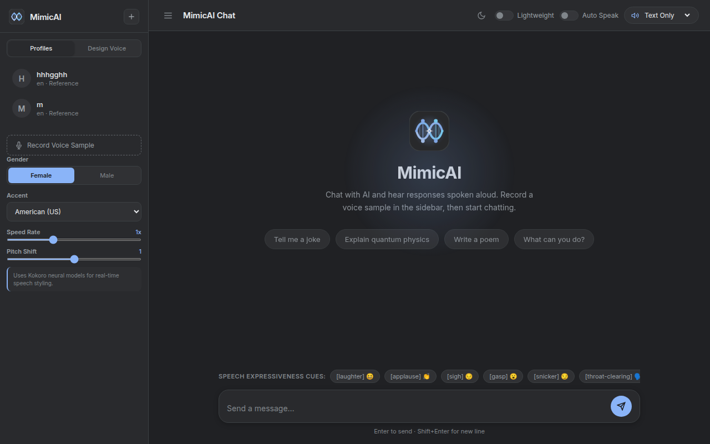

# <p align="center"><br><b>MimicAI</b></p>

<p align="center">
  <b>Simple, fast zero-shot voice cloning and AI voice chatbot.</b><br>
  Built with Piper TTS, Kokoro, F5-TTS, and Google Gemini , Hackclub AI
</p>

<p align="center">
  
</p>

---

## What is MimicAI?

MimicAI is a lightweight AI voice assistant and voice cloning tool. You can record just 5 to 10 seconds of your voice sample, and it will speak back in your exact voice. If you don't want to clone, you can directly design custom voices with different accents, speed, and pitch. 

The whole UI is styled using Google Chrome dark mode colours, so it feels very clean and easy on the eyes.

---

## Main Features

- **Quick Voice Cloning**: Just record 5-10 seconds of clear speech from the sidebar and save the profile. It will clone and speak right away.
- **Voice Designer**: If you don't want to use your own voice, choose between male/female, pick accents (US, UK, Indian English, Japanese), and adjust speed and pitch.
- **Expressiveness Cues**: Easily insert cues like `laughter`, `applause`, or `sigh` into the chat to make speech sound natural.
- **Chrome Dark Mode**: Clean `#202124` palette with  Blue accents. 
- **Multi-Engine Fallbacks**: Uses Piper TTS for instant zerolatency speech, Kokoro for voice design, and F5-TTS / OpenVoice for voice cloning.
- **Gemini Streaming**: Fast answers using Gemini  or Hack Club AI  API

---

## How to Run Locally

### 1. Set up Python virtual environment
Open terminal in the project folder and run:

```bash
python3 -m venv venv
source venv/bin/activate
pip install -r requirements.txt
```

### 2. Add API keys (Optional)
Copy `.env.example` to `.env` if you want to use Google Gemini:

```env
PORT=8000
HOST=127.0.0.1
GEMINI_API_KEY=your_gemini_api_key_here
```

### 3. Start the server
Simply run:

```bash
python3 app.py
```

Then open your browser and go to:
**http://127.0.0.1:8000**

---

## Quick Voice Cloning Guide

1. Open the website on `http://127.0.0.1:8000`.
2. Click **Record Voice Sample** in the left sidebar.
3. Speak clearly for 5 to 10 seconds and click **Save Voice Profile**.
4. Select your saved voice from the dropdown at the top right and start chatting!
